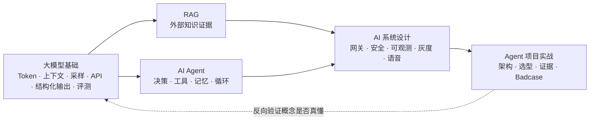

# AI Agent 面试指南（JavaGuide `docs/ai` 全景详解版）

> **数据来源**：[Snailclimb/JavaGuide · `docs/ai`](https://github.com/Snailclimb/JavaGuide/tree/main/docs/ai)（`main` 分支，抓取于 2026-11-09）
> **源文档规模**：40 篇 Markdown、约 1,146,350 字节（≈ 1.15 MB），覆盖大模型基础 / AI Agent / RAG / AI 系统设计 / 面试题与项目实战五大板块
> **本指南定位**：不是又一份题目清单，而是把「题目页列出的题」与「专题文章里分散的答案」逐题对齐后的**可背诵、可追问、可复盘**的详解版。五个部分严格按图示划分：**大模型基础面试题总结 → AI Agent 面试题总结 → Agent 项目面试实战 → RAG 面试题总结 → AI 系统设计面试题总结**，另加「文档内嵌问句速答」与「覆盖核对附录」。
> **版权与口径说明**：内容依据 JavaGuide 开源文档整理并重新组织；文中带 `【补充】` 的段落为结合通用工程经验的延伸，不属于原文。模型能力、上下文窗口、API 参数、框架版本与价格会变化，面试与实际落地请以官方文档为准。

---

## 0.1 这个项目到底在讲什么（源仓库分析）

JavaGuide 的 `docs/ai` 不是「AI 概念科普」，而是一套面向**后端 / Java 工程师转 AI 应用开发**的工程化知识体系。它的组织方式很特别：

- **题目页只列问题、不给答案**：`interview-questions/` 下 4 篇「面试题总结」把考点按章节列成清单，答案散落在对应专题文章里；`agent-project-interview-guide.md` 则专门教怎么讲项目。
- **专题文章负责给机制、图表和工程细节**：每个考点都能回到一篇长文（如 `llm-api-engineering.md`、`harness-engineering.md`、`llm-gateway.md`）。
- **README 负责串联**：顶层 README、四个子专题 README、`interview-questions/README.md` 给出阅读顺序和「高频问题」；`TODO.md` 记录了尚未写但很可能成为未来考点的专题。

| 模块目录 | 文件数 | 体量（字节） | 主要内容 | 对应本指南 |
| --- | ---: | ---: | --- | --- |
| `interview-questions/` | 7 | 80,148 | 4 篇题目页 + 项目实战 + 总入口 + 专题 README | 全部五部分 |
| `llm-basis/` | 5 | 200,415 | 运行机制、API 工程、结构化输出与 Function Calling、评测体系 | 第一部分 |
| `agent/` | 11 | 321,479 | Agent 基础、Memory、Prompt/Context、MCP、Skills、Harness、Multi-Agent、Workflow/Graph/Loop、Loop Engineering | 第二部分 |
| `rag/` | 8 | 211,379 | RAG 基础、文档处理、向量库、检索优化、GraphRAG、知识库更新、评测 | 第四部分 |
| `system-design/` | 6 | 255,588 | 生产架构、模型网关、安全、可观测、实时语音 | 第五部分 |
| 根目录 | 3 | 77,341 | 知识体系总览、AI 核心概念、内容规划 TODO | 第零 / 六部分 |

**三条主线**（也是面试官追问的方向）：

**这个仓库相比传统 AI 八股的新增考点**（最容易在 2026 年的面试里拉开差距）：Harness Engineering 六层检查框架、Loop Engineering 与外层循环、Agent Skills 的延迟加载与路由、Context Engineering 与 Compaction、MCP 的生产安全治理、GraphRAG 的社区摘要与权限过滤、模型网关的 RPM/TPM/租户预算、Trace/Metrics/Audit/Eval Record 的区分、写操作 `actionId` 幂等与超时结果未知、Agent 评测的 Task/Trial/Grader/Eval Harness、实时语音 Agent 的状态机与打断。这些在普通面经里往往没有，本指南都逐题展开。

---

## 0.2 五部分划分（与图示一致）与建议复习顺序

| 图示顺序 | 本指南 | 对应源文档 | 正式题目数 | 考察能力 |
| --- | --- | --- | ---: | --- |
| ① 大模型基础面试题总结 | 第一部分 | `llm-interview-questions.md` + `llm-basis/*` | 39 | 一次模型调用能不能稳定、可控、可评测地跑通 |
| ② AI Agent 面试题总结 | 第二部分 | `agent-interview-questions.md` + `agent/*` | 58 | 会不会设计决策循环、管理上下文与工具、治理 Harness |
| ③ Agent 项目面试实战 | 第三部分 | `agent-project-interview-guide.md` | 55 处追问 / 自测 + 方法论 | 能不能把真实项目讲成「约束 → 选择 → 代价 → 证据」 |
| ④ RAG 面试题总结 | 第四部分 | `rag-interview-questions.md` + `rag/*` | 60 | 会不会定位「召回 / 排序 / 上下文 / 生成」哪一段坏了 |
| ⑤ AI 系统设计面试题总结 | 第五部分 | `ai-system-design-interview-questions.md` + `system-design/*` | 56 | 能不能把 Demo 放进生产：网关、权限、成本、观测、灰度 |

> **文档顺序 vs 复习顺序**：图示顺序 = 官方站点导航顺序，本指南保持；复习时建议 `① → ② → ④ → ⑤ → ③`，先把概念和工程链路补齐，最后用第三部分把知识组织成项目话术。若时间只有一天，直接看 0.6 模板 + 0.7 速查 + 第三部分，再按附录 A 逐题自测。

---

## 0.3 面试官在考什么 / 按经验决定复习深度

Agent 项目没有 CRUD 那样成熟的评价标准，面试官只能靠追问核实三件事：

1. **项目是不是真的**——真做过的人说得出约束、数据、踩过的坑；背项目的人只能复述架构图，追问到第三层就露馅。
2. **有没有技术决策能力**——同一个问题可以用 Prompt、Workflow、RAG、工具调用或 Multi-Agent 解决，要能说清「在我的约束下为什么选它、放弃了什么」。
3. **对系统边界的认知**——模型输出不可靠、状态可能不一致、工具会失败；知道风险并用工程手段兜住，才是能上生产的人。

| 经验阶段 | 复习重点 | 回答要达到的程度 |
| --- | --- | --- |
| 应届 / 0～1 年 | 大模型基础、RAG 链路、Agent Loop、简单应用架构 | 能解释概念，说清一次模型调用或知识库问答的完整流程 |
| 2～3 年 | API 调用工程、RAG 排查、工具治理、状态与可观测 | 能按失败现象定位环节，说明方案取舍与异常处理 |
| 3 年以上 | 模型网关、成本、安全、评测、灰度回滚、架构演进 | 能设计完整系统，说明容量、权限、故障恢复、质量验证与演进 |

---

## 0.4 题目覆盖范围与核对方式

| 类别 | 数量 | 覆盖位置 |
| --- | ---: | --- |
| 4 篇题目页的正式面试题（含综合场景 / 设计 / 排查题） | **213**（39 + 58 + 60 + 56） | 第一、二、四、五部分，逐题保留题干并作答 |
| 项目实战中的追问、自测题与方法论问题 | 55 | 第三部分（逐题 Q&A + 15 道自测题答案） |
| 入口页 / README / TODO 中的高频问题 | 23 | 第三部分与第六部分 |
| 专题文章正文里的问句式考点、检查清单、思考题 | 548 | 各部分「延伸追问」小节 + 第六部分逐条速答 |
| **合计问句式考点** | **839** | **全部有对应答案或速答** |

覆盖核对方法：从 40 篇源文档中抽取所有含问号的列表项 / 标题 / 表格设问，共 839 条；对题面做归一化（去标点、空白、序号、反引号）后与全文答案做前缀匹配，213 道正式题 **213/213 命中**，其余条目由第六部分补齐。附录 A 给出 213 道原题的完整索引，附录 B 给出 40 篇源文档链接，方便逐条回查。

---

## 0.5 本指南的答案结构

每一道正式题按同一结构展开，便于「先背结论、再补论证」：

- **核心结论**：一句话给分点，先让面试官知道你答对了；
- **机制 / 原理**：为什么会这样，涉及哪些组件与数据；
- **工程落地**：生产里具体怎么做（字段、参数、策略、边界）；
- **追问链**：面试官接着会问什么，以及怎么接；
- **易错点 / 加分项**：常见错误答案，以及能体现深度的一句话。

带 `【补充】` 的是源文档未展开、但面试中常被追问的通用工程知识。文中保留源文档的具体字段名（如 `requestId`、`runId`、`toolCallId`、`actionId`、`TIMED_OUT_UNKNOWN`）、版本号（如 Spring AI 2.0.0、AgentScope Java 2.0.1）、指标名（MRR、NDCG、Recall@K、Context Precision、Faithfulness）与参数名（`ef_search`、`ef_construction`、`M`、RPM/TPM），这些细节是区分「看过文档」与「只看过面经」的关键。

**建议用法**：① 打开附录 A，遮住答案逐题自测并标记不会的题；② 回对应部分只精读标记题；③ 用 0.8 的连环追问链做模拟压面；④ 用第三部分的模板把自己的项目写成 30 秒 / 3 分钟 / 10 分钟三版；⑤ 面试前一天只看 0.7 速查表和第三部分 Badcase。

---

## 0.6 直接可套用的回答模板

**① 四要素（任何「为什么这么设计」都能用）**

> 在 **【约束：延迟 / 成本 / 权限 / 数据规模 / 上线时间】** 下，我们比较过 **【候选 A / B / C】**，选择了 **【当前方案】**，因为它解决了 **【具体问题】**；代价是 **【延迟 / 复杂度 / 维护成本】**，我们用 **【控制手段】** 兜住；最后用 **【评测集 / 指标 / 样本量 / 基线版本】** 确认有效。如果 **【约束变化条件】** 出现，我们会换成 **【备选方案】**。

**② 30 秒 / 3 分钟 / 10 分钟项目介绍**

- 30 秒：项目是什么 → 为什么必须用 Agent（不能用普通接口 / 固定 Workflow）→ 我负责哪一段 → 最难的一个问题。
- 3 分钟：业务问题与成功标准 → 一次请求完整链路 → 两个关键技术选择（含备选方案与代价）→ 一个代表性 Badcase → 结果与职责边界。
- 10 分钟：在 3 分钟基础上补架构分层、状态与 Checkpoint、工具治理八道检查、评测集与指标口径、Trace 复盘、容量与后续演进。

**③ 排查类问题（RAG 答非所问 / Agent 答错 / 线上质量下降）**

> 先固化现场（输入、版本、检索结果、工具 Trace、外部状态）→ 描述现象与影响范围 → **分层假设**（数据 / 检索 / 上下文 / 模型 / 工具 / 编排 / 第三方）→ 控制变量一次只改一个 → 拿出可稳定复现的根因证据 → 在正确的一层修复（别只改 Prompt）→ 原 Case + 相邻边界 Case 进回归集 → 观察线上指标。

**④ 设计类问题（企业 RAG / Agent 平台 / 语音客服）**

> 场景与成功标准 → 约束与容量（QPS、Token、延迟、权限、数据量）→ 一次请求链路 → 分层组件与**「不能交给模型」**的职责 → 状态与恢复 → 安全与审计 → 观测与评测 → 灰度 / 回滚 / 降级 → 瓶颈与演进。

**⑤ Badcase 复盘七步**：保存现场 → 描述现象 → 分层假设 → 控制变量 → 确认根因 → 实施修复 → 加入回归用例。

---

## 0.7 高频易混淆概念速查表

| 易混对 | 一句话分界 | 面试加分点 |
| --- | --- | --- |
| Prompt Engineering vs Context Engineering | 前者写「怎么指令」，后者决定「这一轮模型能看到什么」 | Agent 长任务里 Context 比 Prompt 更关键 |
| Context Engineering vs Harness Engineering | 前者管上下文供给，后者管模型外的整个执行环境（任务、工具反馈、验证、恢复） | `Agent = Model + Harness` |
| Function Calling vs MCP Tool | 前者是模型表达「想调哪个函数」的结构化协议，后者是 Host/Client/Server 之间统一的工具与上下文接入协议 | 二者不同层，不能互相替代 |
| MCP Tool vs 普通 HTTP API | MCP Tool 是给模型看的能力描述与调用入口，真正的业务执行仍是后端 HTTP/RPC | 权限、幂等、审计在业务侧 |
| Agent Skill vs Function Calling | Skill 是「完成某类任务的流程 + 资料 + 脚本」，按需延迟加载；Function Calling 只是一次调用意图 | Skill 路由像 RAG，但目标是加载能力不是找证据 |
| Chatbot vs Workflow vs Agent | 路径由用户驱动 / 由代码与图规则驱动 / 由模型在运行时选择动作与路径 | 自然语言入口 ≠ 必须用 Agent |
| RAG vs Memory vs Context vs State | 外部知识证据 / 跨轮次要记住的信息 / 本轮真正发给模型的内容 / 任务进行到哪一步 | 都不能替代权威业务数据库 |
| Workflow vs Graph vs Loop | 流程编排 / 用节点边状态表达流程 / 循环与回边 | Graph 是 Workflow 的一种表达方式 |
| Graph Loop vs Agent Loop | 图结构里由条件边决定的回边 / 模型「观察—决策—行动—观察」的执行循环 | 外层 Loop 由 CI、定时、目标检查、人工审批触发 |
| JSON Mode vs Structured Outputs | 只保证是合法 JSON / 按 Schema 约束字段与类型（更强约束） | 都还需服务端二次校验 |
| Schema 校验通过 vs 允许执行 | 前者只证明格式合法，后者还要身份、权限、业务规则、风险等级、确认 | `Schema ≠ 授权` |
| LLM Gateway vs LLM Router | 网关是统一接入与治理层 / Router 只是其中的路由决策 | 网关还管限流、配额、成本、审计、缓存 |
| 只读重试 vs 写操作重试 | 读可有限重试 / 写必须先幂等 + 状态查询，超时≠失败 | `actionId` + `TIMED_OUT_UNKNOWN` + 对账 |
| 检索质量 vs 生成质量 | Recall@K / MRR / NDCG / Context Precision vs Faithfulness / 答案正确性 | 不分两段就无法定位问题 |
| HNSW vs IVFFLAT | 图索引，高召回低延迟但内存大 / 倒排聚类，建库快、需训练与调 `nprobe` | 都属 ANN，用召回率换延迟 |
| 增量更新 vs 全量重建 | 日常小改走增量 / Embedding 模型或 Chunk 策略变更必须重建 | 版本去重防止新旧文档同时召回 |
| GraphRAG 全局检索 vs 局部检索 | 社区摘要回答全局性问题 / 实体邻居回答具体实体问题 | 成本在建图与社区摘要更新 |
| 直接 vs 间接 Prompt Injection | 用户输入里下指令 / 藏在 RAG 文档、网页、工具结果、MCP 描述里 | 外部内容一律是不可信数据 |
| Trace vs Metrics vs Audit vs Eval Record | 单次执行过程 / 聚合延迟错误率 / 谁批准了外部操作 / 版本间质量对比 | 用同一个 `runId` 关联，不塞一张大表 |
| `requestId` / `runId` / `toolCallId` / `actionId` | 请求 / 一次 Agent 运行 / 一次工具调用 / 一个逻辑业务动作（幂等键） | 多个 ID 各管一件事，别混用 |
| RAG vs 微调 vs 长上下文 | 补外部且会变的知识 / 改行为与格式 / 一次性塞入固定材料 | 常组合使用，不是三选一 |

---

## 0.8 五条高频「连环追问链」（模拟压面用）

1. **「你项目里用了 RAG 吗？」** → 完整链路是什么 → 召回不到怎么排查 → Chunk 为什么这么切 → 为什么要 Hybrid Search / Rerank → 怎么评测（检索 / 生成分开）→ 权限怎么过滤 → 文档更新与多版本去重 → 什么情况该上 GraphRAG。
2. **「这算 Agent 吗？」** → 和 Workflow / 普通接口的区别 → 为什么固定规则不够 → Agent Loop 怎么停（预算、无进展检测）→ 状态怎么存、重启怎么恢复 → 写操作怎么幂等与二次确认 → Trace 记什么 → 怎么评测任务完成率 → 为什么先单 Agent 而不是 Multi-Agent。
3. **「模型 API 怎么调？」** → 流式输出选型 → 哪些错误可重试 → 幂等与重复计费 → 为什么限流不能只看 QPS → 网关能力 → fallback 与不可降级任务 → 成本归因 → 灰度与回滚。
4. **「怎么证明改动有效？」** → 为什么不能只看公开榜单 → Golden Set 冷启动 → LLM-as-Judge 偏差与校准 → RAG / Agent / 结构化输出指标为何不同 → 离线评测 / Trace 回放 / 线上灰度 → 评测记录绑定哪些版本 → 质量下降怎么归因。
5. **「安全怎么做？」** → 直接与间接注入 → 工具 description 为何不能替代鉴权 → Schema 校验后为什么还不能执行 → 风险分级与二次确认 → 审计字段 → 沙箱与最小权限 → MCP Server 供应链风险。

---

## 0.9 复习计划

| 时长 | 安排 |
| --- | --- |
| **1 天（突击）** | 0.6 模板 + 0.7 速查 + 0.8 追问链 → 第三部分项目实战（含 15 道自测）→ 附录 A 快速扫题，标出不会的题回查对应部分 |
| **3 天** | Day1 第一部分 + 第二部分上半（Agent 基础 / Memory / Prompt / Context）；Day2 第二部分下半（MCP / Skills / Harness / Workflow）+ 第四部分 RAG；Day3 第五部分系统设计 + 第三部分项目实战 + 模拟压面 |
| **7 天** | 按 `① → ② → ④ → ⑤ → ③` 每天一个部分，第 6 天做第六部分延伸速答与错题回炉，第 7 天按 0.8 做两轮 30 分钟模拟面试，并用第三部分模板写自己的项目复盘表 |

---

## 0.10 目录与约定

- **第一部分** 大模型基础面试题总结（39 题 + 篇内延伸追问）
- **第二部分** AI Agent 面试题总结（58 题 + 篇内延伸追问）
- **第三部分** Agent 项目面试实战（方法论逐题化 + 15 道自测 + 项目经历高频追问 + 可复用模板）
- **第四部分** RAG 面试题总结（60 题 + 篇内延伸追问）
- **第五部分** AI 系统设计面试题总结（56 题 + 篇内延伸追问）
- **第六部分** 文档内嵌问句式考点速答（110 条检查清单 / 设问 + 未来预测题）
- **附录 A** 213 道原题覆盖索引｜**附录 B** 40 篇源文档索引｜**附录 C** 复习自评表

文中 `Q1-1`、`Q1`、`题 1`、`Q-A01` 等编号只是各部分的内部题号，与附录 A 的原题顺序一一对应；源文档里以 `<!-- @include -->` 引入的站点组件与广告片段不纳入本指南。源文档中另有《上下文工程(Context Engineering) 是什么？和 Prompt Engineering 有什么区别？》一文，其考点并入第二部分 Q17，可对照阅读。延伸自测：上下文工程 是什么？和 Prompt Engineering 有什么区别？
